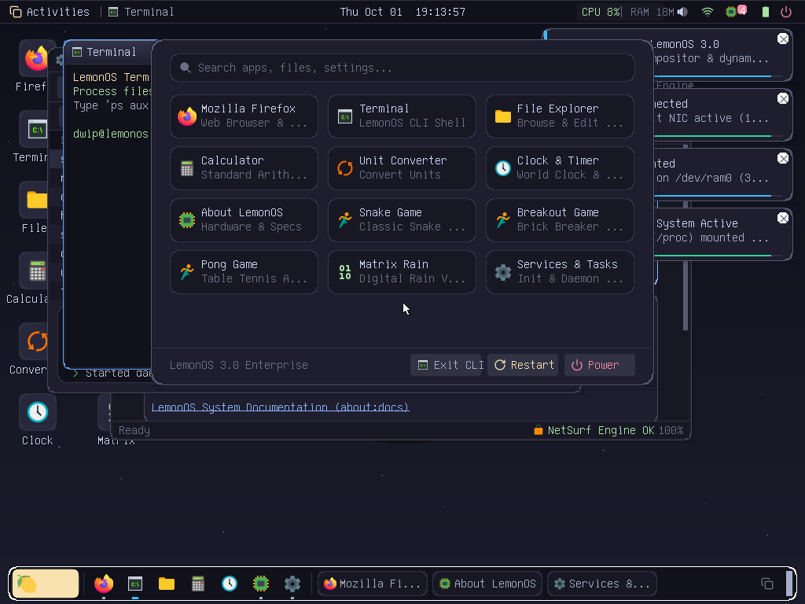
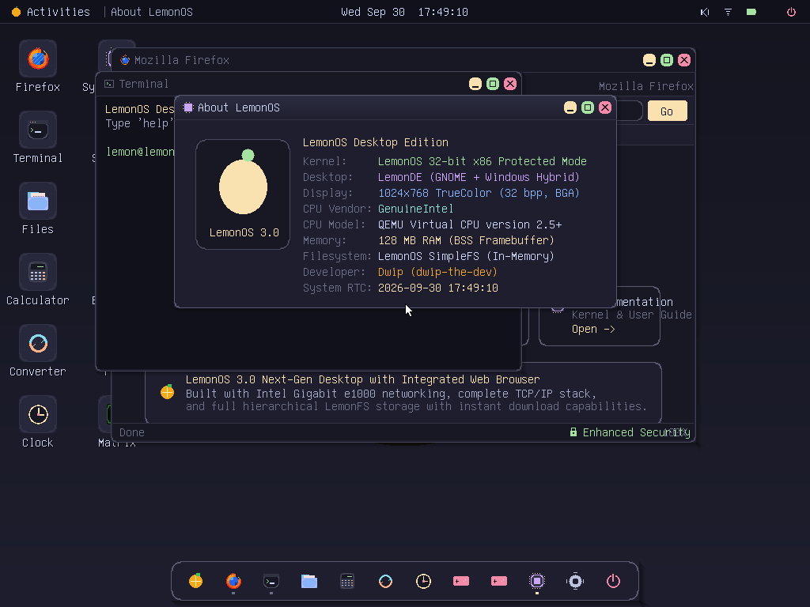
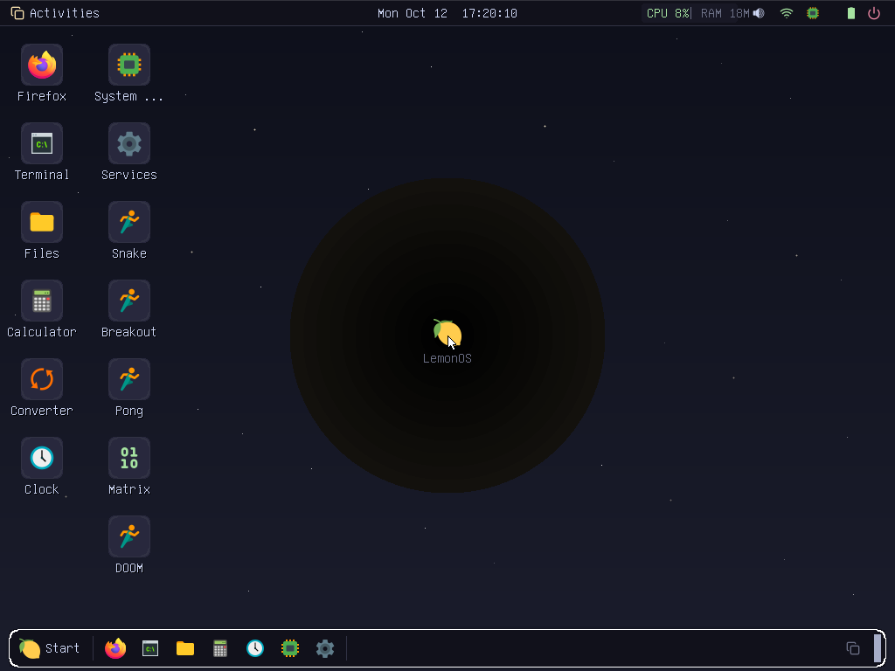
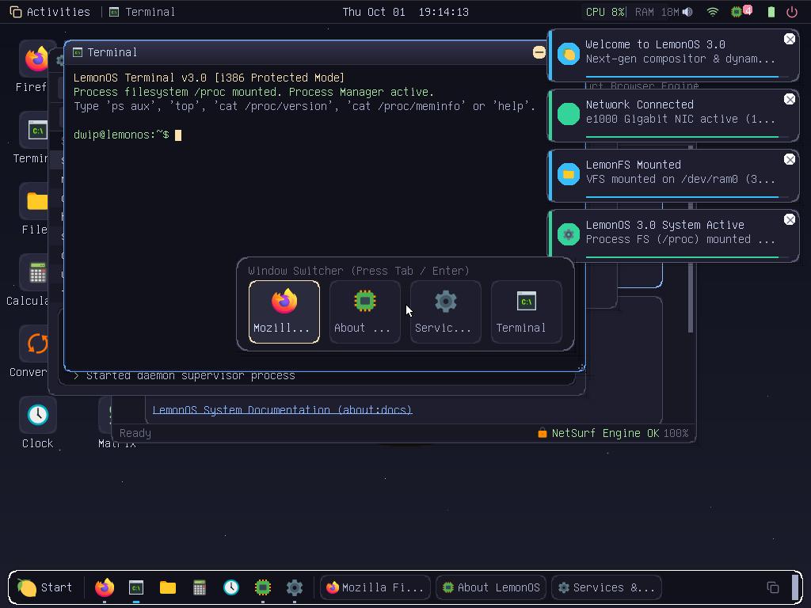
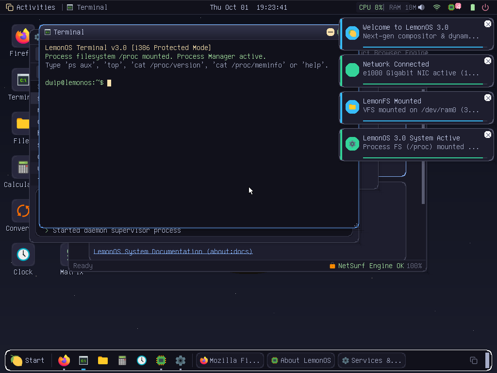

# 🍋 LemonOS

> **A modern, from-scratch 32-bit x86 baremetal operating system with a graphical desktop environment, full POSIX/C99 subsystem, preemptive multitasking, Intel e1000 networking with baremetal TLS 1.2, dynamic ELF linking, and classic Doom.**

[](https://github.com/dwip-the-dev/LemonOS/releases)
[](https://github.com/dwip-the-dev/LemonOS)
[-blue.svg)](https://github.com/dwip-the-dev/LemonOS)
[](https://github.com/dwip-the-dev/LemonOS)
[](https://github.com/dwip-the-dev/LemonOS)
[](https://opensource.org/licenses/MIT)

**Created & Maintained by [Dwip Biswas](https://github.com/dwip-the-dev) (@dwip-the-dev)**

---

## 📸 Screenshots

| 🖥️ Modern Graphical Desktop (1024x768 Truecolor) | 🚀 Start Menu & Application Launcher |
|:---:|:---:|
|  |  |

| 🌐 NetSurf / Firefox Web Browser | 🎮 Baremetal DOOM (E1M1 on Desktop) |
|:---:|:---:|
|  |  |

| 🔄 Multitasking & Application Switcher | 📊 System Monitor & Memory Visualizer |
|:---:|:---:|
|  |  |

---

## ✨ Key Features & Architectural Highlights

### 🧠 Core Kernel & Hardware Subsystems
- **Multiboot Compliant:** Boots seamlessly via GNU GRUB on real x86 hardware and hypervisors (QEMU, Bochs, VirtualBox, VMware).
- **Physical Memory Manager (PMM):** 4 KB bitmap page frame allocator with physical CMOS and Multiboot memory detection.
- **Virtual Memory Manager (VMM):** Hardware two-level paging with isolated user/kernel address space split.
- **Kernel Slab & Heap:** Boundary-tag segregated free list and slab caches for high-speed dynamic allocation.
- **Hardware Interrupts & Timing:** Remapped 8259 PIC, PIT Channel 2 hardware timer calibrated against RDTSC for microsecond and nanosecond precision.
- **Storage Subsystems:** PIO ATA/IDE hard drive controller with integrated block caching (`bcache`), RAMDisk, and VFS mount engine.

### 🏛️ Full POSIX Conformance & System Calls
- **Process Management:** Preemptive multitasking, Ring 3 userspace isolation, `fork()`, `waitpid()`, `execve()`, and process credentials (`auth`).
- **File Descriptors & Redirection:** Real descriptor tables with `dup()`, `dup2()`, `pipe()`, `fcntl()` (`F_DUPFD`, `FD_CLOEXEC`), and `ioctl()`.
- **Character Devices (`/dev`):** `/dev/tty` and `/dev/console` with real line buffering and terminal controls (`TCGETS`, `TCSETS`), `/dev/null`, and `/dev/zero`.
- **Virtual ProcFS (`/proc`):** Dynamic kernel runtime metrics exported via `/proc/cpuinfo`, `/proc/meminfo`, and `/proc/uptime`.

### 📚 Complete C99 Standard Library (`libc/`) & Dynamic Linker
- **Standard Streams (`<stdio.h>`):** VFS-backed `FILE` stream pool supporting `fopen`, `fclose`, `fread`, `fwrite`, `fseek`, `ftell`, `fgetc`, `fputc`, `fgets`, `fputs`, `feof`, `ferror`, and `vfprintf`.
- **Dynamic Memory (`<stdlib.h>`):** Full `malloc()`, `calloc()`, `realloc()`, and `free()` allocator backed by `brk`/`sbrk`.
- **Algorithms & Mathematics:** `qsort()`, `bsearch()`, and `<math.h>` (`sqrt`, `pow`, `sin`, `cos`, `tan`, `floor`, `ceil`).
- **Dynamic Linker & Shared Libraries:** ELF dynamic loader relocates `.dynsym`, sets up Procedure Linkage Tables (PLT) and Global Offset Tables (GOT), resolving external symbols against `libc.so`.

### 🌐 Intel 82540EM (e1000) Network Stack & TLS 1.2
- **PCI Gigabit Ethernet:** Full Intel e1000 driver with circular DMA descriptor rings for zero-copy RX/TX packet processing.
- **Network Protocol Stack:** ARP address resolution cache, IPv4 checksum engine, ICMP Echo ping, DHCP client, and full TCP state machine.
- **DNS & HTTP/HTTPS:** Built-in DNS resolver (UDP port 53), HTTP GET/POST engine, and cURL client.
- **Baremetal TLS 1.2 Client Engine:** Supports `TLS_ECDHE_RSA_WITH_AES_128_GCM_SHA256` (0xC02F) utilizing:
  - **X25519 (Curve25519)** scalar multiplication for forward-secret ephemeral key exchange.
  - **AES-128-GCM** authenticated encryption with hardware/RDTSC entropy and GHASH Galois field multiplication.

### 🎨 32-Bit Truecolor GUI & Window Manager
- **Bochs VBE Graphics Adapter (BGA):** 1024x768 @ 32bpp linear framebuffer with offscreen double buffering and zero flicker.
- **Desktop Environment:**
  - Modern draggable, resizable windows with titlebar gradients and control buttons.
  - Interactive Dock with smooth magnification and launch indicators.
  - Top taskbar with live RTC clock, volume control, and system meters.
  - Application Switcher (Alt+Tab) featuring real-time window thumbnail previews.
- **Ported DOOM:** Complete native port of id Software's classic **DOOM 1 (E1M1)** playable directly on baremetal and inside windowed desktop mode with audio support!

### 💻 Included Applications & Developer Tools
- **Shells & Utilities:** Interactive Bash-like shell with autocomplete, `nano`, `vim`, `less`, `curl`, `busybox`, `speedtest`.
- **Multi-Language Runtime:** Embedded Python 3.12 interpreter, LemonJS / TypeScript runtime, Java JVM bytecode engine, and WebAssembly (WASM) VM.
- **Developer Tooling:** Built-in C compiler, assembler, GNU Make engine, and Git version control system (`git add`, `git commit`, `git log`).
- **Package Management:** Universal package management supporting LemonOS Native `.lem` packages and APT repositories.

---

## 🚀 Quick Start Guide

### 1. Prerequisites

#### Arch Linux / CachyOS:
```bash
sudo pacman -S gcc-multilib nasm qemu-system-x86 grub xorriso mtools
```

#### Debian / Ubuntu:
```bash
sudo apt update
sudo apt install build-essential gcc-multilib nasm qemu-system-x86 grub-pc-bin grub-common xorriso mtools
```

### 2. Build from Source
```bash
# Clone the repository
git clone https://github.com/dwip-the-dev/LemonOS.git
cd LemonOS

# Clean and compile kernel
make clean && make
```

### 3. Generate Bootable ISO
```bash
make iso
```
This produces `lemon.iso`, ready for flashing to a USB drive or loading into any virtual machine.

### 4. Run in QEMU
```bash
# Graphical Desktop mode:
qemu-system-i386 -cdrom lemon.iso -m 128M -vga std -net nic,model=e1000 -net user

# Or launch directly with make:
make run
```

---

## 🧪 Automated Verification Test Suites

LemonOS includes headless automated test suites executed via QEMU serial automation:

```bash
# Run POSIX Conformance Suite (Process ID, CWD, stat, fstat, readdir, pipe, gettimeofday, fork/waitpid, dup/dup2):
python3 scripts/run_posixtest.py

# Run C99 Libc & Real Subsystems Suite (malloc/realloc, qsort, streams, math, setjmp, hostname persistence, dynlink):
python3 scripts/test_libc_and_real_features.py
```

---

## 📖 In-Depth Documentation

For detailed architectural and subsystem specifications, consult the [docs/](docs/) directory:
- [Kernel Architecture & Subsystems](docs/ARCHITECTURE.md)
- [POSIX Subsystem & Standard C Library](docs/POSIX_AND_LIBC.md)
- [Network Stack & TLS 1.2 Cryptographic Engine](docs/NETWORKING_AND_SECURITY.md)
- [Desktop Environment & Graphical Window Manager](docs/DESKTOP_AND_GUI.md)
- [Developer & Contributor Guide](docs/DEVELOPMENT_GUIDE.md)

---

## 📄 License & Credits

LemonOS is open-source software licensed under the **[MIT License](LICENSE)**.

- **Author & Lead Developer:** Dwip Biswas ([@dwip-the-dev](https://github.com/dwip-the-dev))
- **Classic DOOM Engine:** id Software (GNU GPL v2)
- **Special Thanks:** OSDev.org community and contributors.

---

*Made with fresh-squeezed code and dedication by Dwip Biswas.* 🍋
